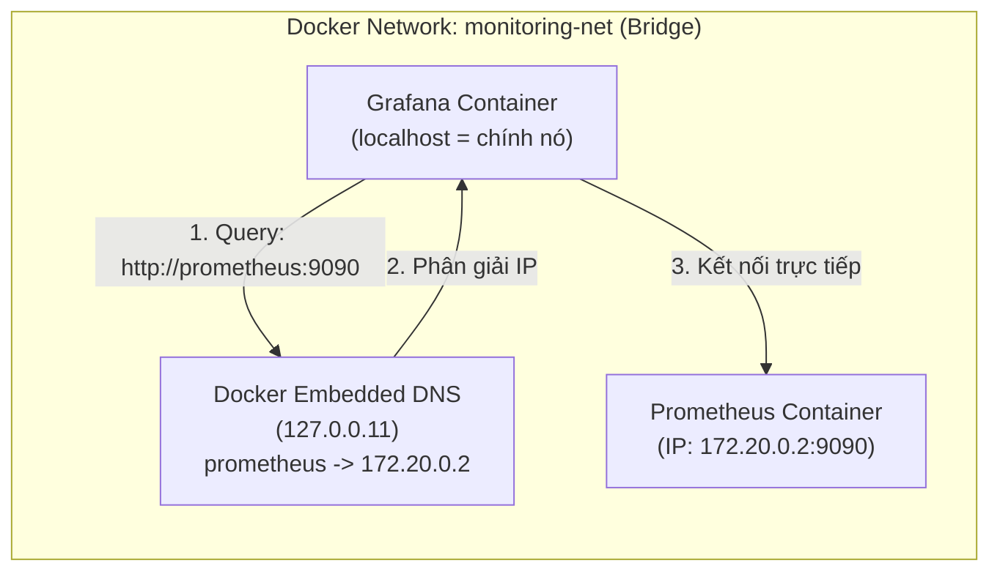

# BÁO CÁO KỸ THUẬT: HỆ THỐNG GIÁM SÁT TOÀN DIỆN VỚI PROMETHEUS & GRAFANA (NOC)

- **Dự án**: QuickBite Microservices Platform
- **Học phần**: Monitoring, Alerting & Observability
- **Tác giả**: NamNT (NamNTHE176286)
- **Repository**: [NamNT2942003/14](https://github.com/NamNT2942003/14)

---

## MỤC LỤC
1. [Bài 1: Vận dụng cơ bản - "Giao tiếp giữa 2 người khổng lồ" (Grafana & Prometheus)](#bài-1-vận-dụng-cơ-bản---giao-tiếp-giữa-2-người-khổng-lồ)
2. [Bài 2: Vận dụng cơ bản - "Vẽ biểu đồ sức khỏe VPS" (PromQL & Panel Units)](#bài-2-vận-dụng-cơ-bản---vẽ-biểu-đồ-sức-khỏe-vps)
3. [Bài 3: Vận dụng chuyên sâu - "Đứng trên vai người khổng lồ" (Import Template 4701 & JVM)](#bài-3-vận-dụng-chuyên-sâu---đứng-trên-vai-người-khổng-lồ)
4. [Bài 4: Vận dụng chuyên sâu - "Bảng điều khiển động" (Variables & Dynamic Dashboard)](#bài-4-vận-dụng-chuyên-sâu---bảng-điều-khiển-động)
5. [Bài 5: Phân tích kỹ thuật - "Cuộc chiến Cảnh báo: Grafana Alerts vs Alertmanager"](#bài-5-phân-tích-kỹ-thuật---cuộc-chiến-cảnh-báo-grafana-alerts-vs-alertmanager)
6. [Bài Tập Thực Hành: Xây dựng Trung tâm Giám sát Điều hành (NOC)](#bài-tập-thực-hành-xây-dựng-trung-tâm-giám-sát-điều-hành-noc)

---

## BÀI 1: VẬN DỤNG CƠ BẢN - "GIAO TIẾP GIỮA 2 NGƯỜI KHỔNG LỒ"

### 1. Cấu hình Docker Compose kết nối Grafana và Prometheus
Dịch vụ Grafana được tích hợp vào cụm `docker-compose.yml`, mở cổng `3000:3000` và kết nối cùng mạng bridge `monitoring-net`:

```yaml
services:
  prometheus:
    image: prom/prometheus:v2.51.0
    container_name: prometheus
    ports:
      - "9090:9090"
    networks:
      - monitoring-net

  grafana:
    image: grafana/grafana:10.4.1
    container_name: grafana
    ports:
      - "3000:3000"
    environment:
      - GF_SECURITY_ADMIN_USER=admin
      - GF_SECURITY_ADMIN_PASSWORD=admin
    networks:
      - monitoring-net
```

### 2. Các bước cấu hình Prometheus làm Data Source trên Grafana
1. Mở trình duyệt truy cập: `http://localhost:3000` (Tài khoản: `admin` / `admin`).
2. Tại menu bên trái, chọn **Connections** $\rightarrow$ **Data sources** (hoặc truy cập `http://localhost:3000/datasources`).
3. Nhấn **Add data source**, chọn **Prometheus**.
4. Tại ô **Prometheus server URL**, nhập chính xác: `http://prometheus:9090`.
5. Cuộn xuống nhấn nút **Save & test**. Khi xuất hiện thông báo xanh lá `Successfully queried the Prometheus API.` là kết nối thành công.

### 3. Phân tích bẫy kỹ thuật: `http://localhost:9090` vs `http://prometheus:9090`
- **Đáp án**: URL bắt buộc phải là **`http://prometheus:9090`**.
- **Giải thích dựa trên kiến trúc mạng Docker Compose**:
  - **Network Namespace cô lập**: Mỗi container Docker chạy trên một network namespace riêng rẽ và có loopback interface (`127.0.0.1` / `localhost`) độc lập. Khi đứng bên trong container `grafana`, `localhost` đại diện cho chính nó, không phải Prometheus hay máy host.
  - **Embedded DNS & Service Discovery**: Docker Compose tự động tạo một mạng bridge riêng (`monitoring-net`) và kích hoạt **Embedded DNS Server** (IP `127.0.0.11`). DNS này tự động phân giải service name `prometheus` thành IP nội bộ của container Prometheus.



---

## BÀI 2: VẬN DỤNG CƠ BẢN - "VẼ BIỂU ĐỒ SỨC KHỎE VPS"

### 1. Panel 1: Biểu đồ Time series - Mức sử dụng CPU hiện tại (%)
- **Câu truy vấn PromQL**:
  ```promql
  100 - (avg by (instance) (rate(node_cpu_seconds_total{mode="idle"}[5m])) * 100)
  ```
- **Giải thích**:
  - `rate(node_cpu_seconds_total{mode="idle"}[5m])`: Tính tỷ lệ thời gian CPU ở trạng thái rảnh rỗi (`idle`) trong 5 phút gần nhất.
  - `avg by (instance) (...)`: Lấy trung bình toàn bộ core CPU theo từng instance.
  - `100 - (...) * 100`: Lấy 100% trừ đi % rảnh rỗi để có được % CPU đang thực sự bận rộn xử lý.
- **Cấu hình Panel bên phải**:
  - **Visualization**: `Time series`.
  - **Standard options $\rightarrow$ Unit**: `Misc` $\rightarrow$ `Percent (0-100)`.
  - **Min**: `0`, **Max**: `100`.

### 2. Panel 2: Biểu đồ Stat - Tổng lượng RAM còn trống (Free RAM)
- **Câu truy vấn PromQL**:
  ```promql
  node_memory_MemFree_bytes
  ```
- **Phân tích bẫy kỹ thuật (Đơn vị Bytes vs MB/GB)**:
  - *Vấn đề*: Metric trả về đơn vị thô là Bytes. Không nên chia thủ công trong câu truy vấn (`node_memory_MemFree_bytes / 1024 / 1024`) vì sẽ làm mất ngữ cảnh kiểu dữ liệu, khiến Grafana không tự co giãn đơn vị khi dung lượng RAM tăng giảm.
  - *Cách cấu hình chuẩn xác trên Grafana UI*:
    - Tại thanh cấu hình bên phải, tìm mục **Standard options** $\rightarrow$ **Unit**.
    - Chọn **Data** $\rightarrow$ **bytes (IEC)** (hoặc **bytes (Metric)**). Grafana sẽ tự động định dạng và co giãn hiển thị thông minh (ví dụ: `512 MiB`, `2.4 GiB`).
    - Nếu sếp yêu cầu cố định chỉ hiển thị MB: chọn **Data** $\rightarrow$ **Megabytes**.
    - Tại mục **Stat styles** $\rightarrow$ **Calculation**: Chọn `Last *` (lấy giá trị thời gian thực gần nhất).

---

## BÀI 3: VẬN DỤNG CHUYÊN SÂU - "ĐỨNG TRÊN VAI NGƯỜI KHỔNG LỒ"

### 1. Các bước Import Dashboard bằng ID 4701 (JVM Micrometer)
1. Truy cập Grafana $\rightarrow$ menu bên trái chọn **Dashboards**.
2. Nhấn nút **New** $\rightarrow$ chọn **Import** (hoặc truy cập `http://localhost:3000/dashboard/import`).
3. Tại ô **Import via grafana.com**, nhập ID: `4701` và bấm **Load**.
4. Chọn Data Source **Prometheus** đã tạo và bấm nút **Import**.

### 2. Mô tả 3 biểu đồ quan trọng nhất đối với ứng dụng Java (JVM)

| Tên biểu đồ | Metric PromQL sử dụng | Ý nghĩa & Cảnh báo nghiệp vụ |
| :--- | :--- | :--- |
| **1. JVM Memory (Heap: Used vs Committed vs Max)** | `jvm_memory_used_bytes{area="heap"}`<br>`jvm_memory_committed_bytes{area="heap"}`<br>`jvm_memory_max_bytes{area="heap"}` | • **Ý nghĩa**: Giám sát mức tiêu thụ bộ nhớ Heap (Eden, Survivor, Old Gen).<br>• **Cảnh báo**: Nếu đường `Used` tăng liên tục dạng bậc thang và không hạ xuống sau các chu kỳ GC, ứng dụng đang bị **Rò rỉ bộ nhớ (Memory Leak)**, sắp dẫn đến `java.lang.OutOfMemoryError: Java heap space`. |
| **2. Garbage Collection (GC Pause Time)** | `rate(jvm_gc_pause_seconds_sum[1m])`<br>`rate(jvm_gc_pause_seconds_count[1m])` | • **Ý nghĩa**: Đo thời gian và tần suất JVM tạm dừng luồng ứng dụng (**Stop-The-World**) để thu gom rác.<br>• **Cảnh báo**: GC Pause time quá dài (> 200ms) sẽ gây ra **Latency Spikes** (đột biến độ trễ API), làm khách hàng timeout và nghẽn CPU. |
| **3. JVM Threads (Live vs Peak vs Daemon)** | `jvm_threads_live_threads`<br>`jvm_threads_peak_threads`<br>`jvm_threads_daemon_threads` | • **Ý nghĩa**: Giám sát số luồng đang hoạt động song song trong JVM.<br>• **Cảnh báo**: Số thread tăng mất kiểm soát cảnh báo **Thread Leak** hoặc hiện tượng **Deadlock** khi chịu tải cao. |

### 3. Phân tích bẫy kỹ thuật: Khắc phục lỗi "No data" do thiếu tag `application`
- **Nguyên nhân**: Dashboard 4701 khai báo biến `$application` truy vấn qua `label_values(jvm_classes_loaded_classes, application)`. Nếu Spring Boot không gắn tag định danh `application` cho metrics, biến này sẽ rỗng và toàn bộ panel đều bị "No data".
- **Khắc phục trong `application.yml`**:
  ```yaml
  management:
    endpoints:
      web:
        exposure:
          include: health,info,prometheus,metrics
    metrics:
      tags:
        application: ${spring.application.name}  # <-- DÒNG BỊ THIẾU QUYẾT ĐỊNH
  ```

---

## BÀI 4: VẬN DỤNG CHUYÊN SÂU - "BẢNG ĐIỀU KHIỂN ĐỘNG"

### 1. Hướng dẫn tạo biến (Variable) `instance`
1. Vào **Dashboard settings** (biểu tượng bánh răng ở góc trên bên phải) $\rightarrow$ chọn **Variables** $\rightarrow$ bấm **Add variable**.
2. Thiết lập thông số:
   - **Name**: `instance`
   - **Type**: `Query`
   - **Data source**: `Prometheus`
   - **Query**:
     ```promql
     label_values(node_uname_info, instance)
     ```
   - **Selection options**: Bật `Multi-value` (chọn nhiều server) và `Include All option` (chọn tất cả server).
3. Bấm **Apply** và **Save dashboard**.

### 2. Phân tích bẫy kỹ thuật: Viết lại câu truy vấn có chứa biến
- **Câu truy vấn cũ (viết cứng IP)**:
  ```promql
  node_memory_MemFree_bytes{instance="192.168.1.10:9100"}
  ```
- **Câu truy vấn mới (chuẩn Best Practice)**:
  ```promql
  node_memory_MemFree_bytes{instance=~"$instance"}
  ```
- **Giải thích bẫy**: Khi bật `Multi-value` hoặc `All`, biến `$instance` trả về biểu thức regex dạng `(server1|server2)`. Nếu dùng toán tử gán `=` sẽ bị lỗi không khớp và báo No data; bắt buộc phải dùng toán tử Regex Match **`=~`** để hỗ trợ hoàn hảo cả 1 server lẫn nhiều server.

---

## BÀI 5: PHÂN TÍCH KỸ THUẬT - "CUỘC CHIẾN CẢNH BÁO: GRAFANA ALERTS VS ALERTMANAGER"

### 1. Rủi ro Single Point of Failure (SPOF) của Grafana
- Grafana là công cụ **Visualization**. Nếu máy chủ Grafana bị sập (hết RAM, OOM kill, ngắt mạng), **tiến trình Alert Engine của Grafana sẽ chết hoàn toàn**.
- Hậu quả: Không có cảnh báo nào được gửi đi (hiện tượng **Silent Failure**). Hệ thống production sập trong im lặng mà đội ngũ on-call không hề nhận được notification.

### 2. Mô hình High Availability (HA): Alertmanager vs Grafana Alerts
- **Alertmanager HA**: Sử dụng mạng Mesh Network ngang hàng (P2P) qua giao thức Gossip (HashiCorp Memberlist). Không phụ thuộc bất kỳ database tập trung nào. Nhiều node Alertmanager tự động khử trùng lặp cảnh báo (Deduplication) và chuyển tiếp tin cậy.
- **Grafana Alerts HA**: Phải phụ thuộc vào cơ sở dữ liệu chung (PostgreSQL/MySQL) để lưu state và locking. Nếu cơ sở dữ liệu này gặp trục trặc, toàn bộ cụm cảnh báo của Grafana lập tức bị tê liệt.

### 3. Khuyết điểm của Click-Ops (Giao diện Grafana) trong IaC và CI/CD
- **Không có Version Control & Audit Trail**: Sửa bằng tay trên GUI không lưu lại lịch sử commit, không biết ai đã đổi ngưỡng cảnh báo, lúc nào và vì lý do gì.
- **Không thể Code Review (Pull Request)**: Không có quy trình phê duyệt rà soát trước khi đẩy lên production, dễ dẫn đến lỗi thao tác người dùng (Human Error).
- **Khó khăn khi Rollback & Tự động hóa**: Không thể tự động deploy đồng bộ giữa môi trường Dev/Staging/Production; không thể rollback tức thì bằng `git revert`.
- **Alertmanager với GitOps**: Toàn bộ luật được viết dưới dạng file YAML (`alert.rules.yml`, `alertmanager.yml`), lưu trữ trên Git, kiểm tra cú pháp tự động bằng CI với lệnh:
  ```bash
  promtool check rules alert.rules.yml
  amtool check-config alertmanager.yml
  ```

---

## BÀI TẬP THỰC HÀNH: XÂY DỰNG TRUNG TÂM GIÁM SÁT ĐIỀU HÀNH (NOC)

### 1. Kiến trúc All-in-one Docker Compose
Cụm dịch vụ hợp nhất bao gồm:
- **`backend`**: Ứng dụng QuickBite User Service chạy trên cổng `8081`.
- **`prometheus`**: Cổng `9090`, cào metrics định kỳ 5s từ backend và node-exporter.
- **`grafana`**: Cổng `3000`, tự động provision Data Source Prometheus qua file cấu hình.
- **`node-exporter`**: Cổng `9100`, đo metrics phần cứng VPS.
- **`alertmanager`**: Cổng `9093`, quản lý và điều hướng cảnh báo.

### 2. Cơ chế Datasource Auto Provisioning
File `grafana/provisioning/datasources/datasources.yml` được mount vào container Grafana giúp tự động khởi tạo kết nối tới Prometheus ngay khi khởi động:
```yaml
apiVersion: 1
datasources:
  - name: Prometheus
    type: prometheus
    access: proxy
    url: http://prometheus:9090
    isDefault: true
    editable: true
```

### 3. Vẽ biểu đồ lưu lượng HTTP Requests `/api/hello`
- **PromQL**:
  ```promql
  sum(rate(http_server_requests_seconds_count{uri="/api/hello"}[1m]))
  ```
- **Panel format**: `Time series`, Unit: `Throughput -> requests/sec (rps)`.

### 4. Cấu hình Alerting cho lỗi HTTP 500
- **Alert Rule**:
  ```promql
  sum(rate(http_server_requests_seconds_count{status="500"}[1m])) > 0
  ```
- **Evaluation Behavior**: Đánh giá mỗi `10s` trong khoảng thời gian `30s`.
- **Contact point**: Tích hợp Telegram Bot hoặc Slack Webhook.

### 5. Hướng dẫn kiểm thử và kích hoạt cảnh báo (Testing & Verification)
1. Khởi động toàn bộ hệ thống:
   ```bash
   docker compose up -d --build
   ```
2. Gửi request thông thường tới `/api/hello`:
   ```bash
   curl http://localhost:8081/api/hello
   ```
3. Giả lập sự cố bằng cách gọi liên tục endpoint lỗi `/api/error`:
   ```powershell
   for ($i=1; $i -le 30; $i++) { curl http://localhost:8081/api/error ; Start-Sleep -Milliseconds 300 }
   ```
4. Quan sát trên Grafana Alerting: Alert Rule `Backend_HTTP_500_Error_Spike` chuyển sang trạng thái **Firing** và gửi tin nhắn cảnh báo tức thì về Telegram/Slack!

---
*Báo cáo hoàn thành đầy đủ các yêu cầu bài tập và sẵn sàng nộp bài trên Portal.*
